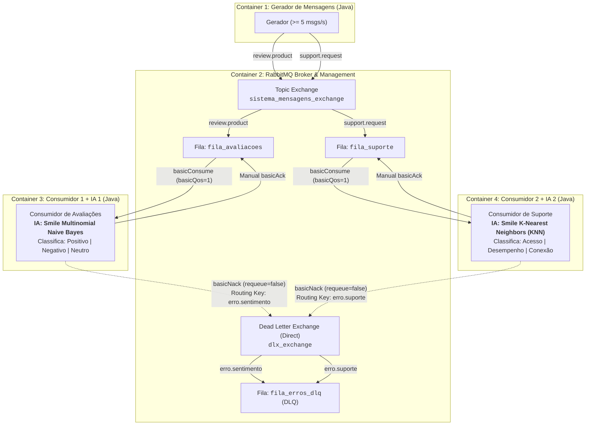
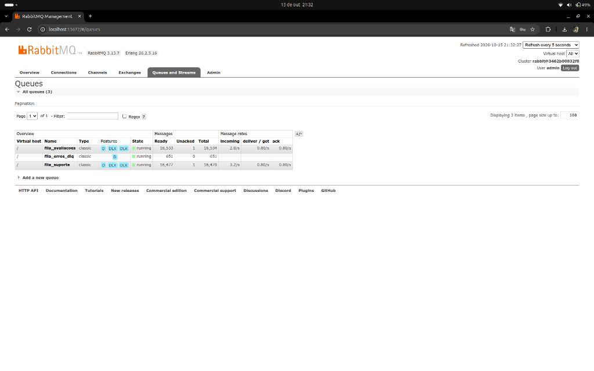
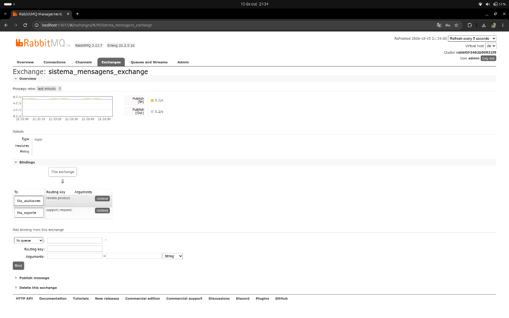
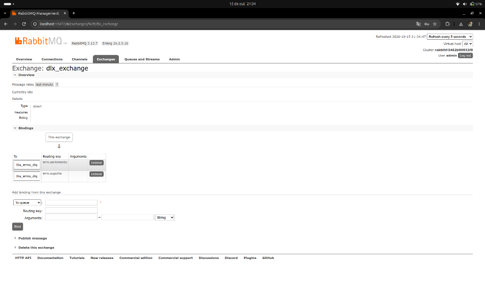
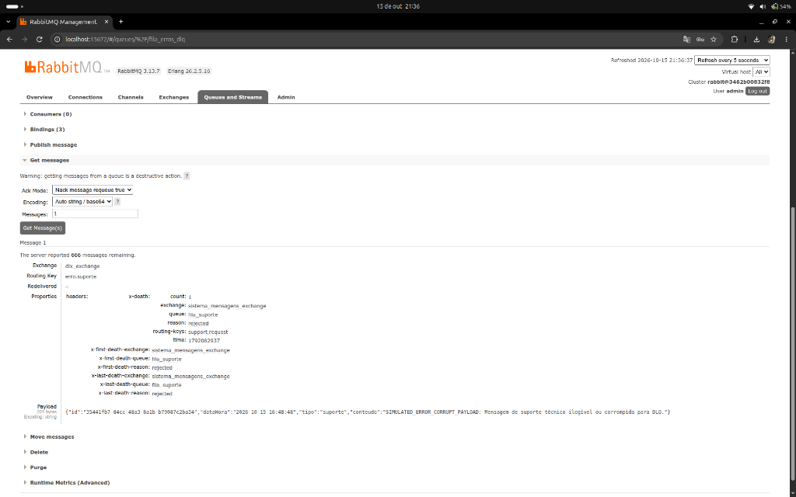
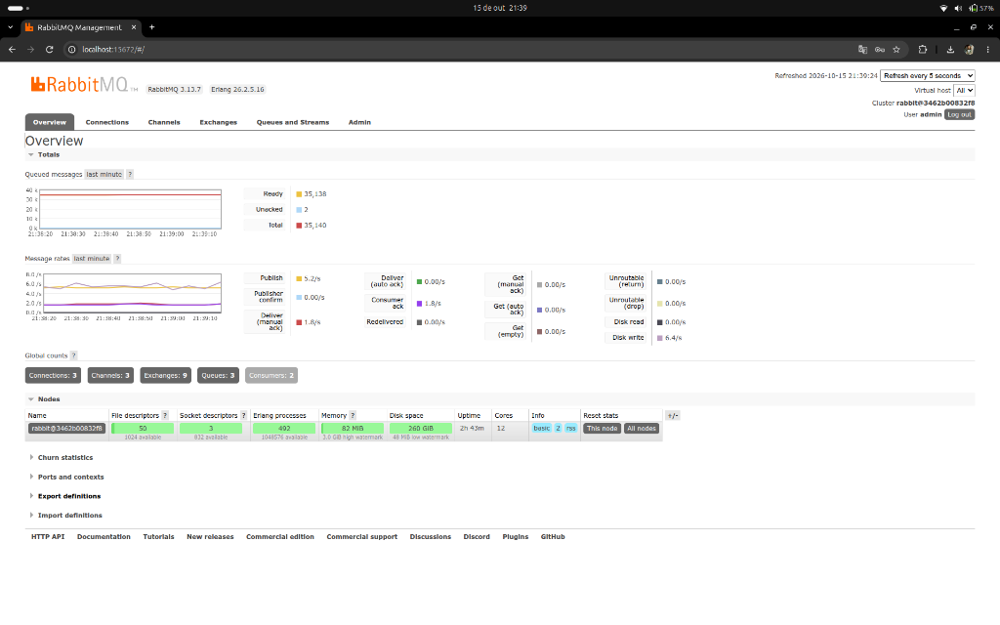

# Atividade 5 – Sistema Distribuído de Classificação Inteligente de Mensagens com RabbitMQ


Este repositório contém a implementação completa de um sistema distribuído de mensageria assíncrona, orquestrado via Docker Compose, utilizando **Java 17**, **RabbitMQ (Topic Exchange & Dead Letter Queue)** e **Inteligência Artificial embarcada (Smile Machine Learning)** para geração, distribuição, classificação e tratamento de falhas de mensagens em tempo real.

---

## 🏛️ Arquitetura do Sistema

O sistema é composto por **4 containers Docker** conectados à mesma rede bridge isolada (`rabbitmq_net`):



---

## 📦 Detalhamento dos Componentes

### 1. Container 1 – Gerador de Mensagens (`gerador-mensagens`)
* **Taxa contínua**: Publica continuamente mais de 5 mensagens por segundo (~5.26 msg/s com intervalo de 190ms).
* **Dois tipos de mensagens**:
  1. **Avaliações de produtos** (`review.product`): comentários diversificados com sentimentos positivos, negativos e neutros.
  2. **Solicitações de suporte** (`support.request`): relatos de incidentes técnicos nas categorias de acesso, desempenho e conexão.
* **Formato estruturado JSON**: Cada mensagem possui obrigatoriamente:
  * `id`: Identificador único UUID v4.
  * `dataHora`: Timestamp de geração (`yyyy-MM-dd HH:mm:ss`).
  * `tipo`: Tipo textual (`avaliacao` ou `suporte`).
  * `conteudo`: Texto da mensagem.
* **Simulação de Falhas para a DLQ**: A cada ~25 mensagens (~4%), o gerador injeta propositalmente um payload marcado como corrompido para comprovar o encaminhamento automático à DLQ.
* **Resiliência**: Implementa loop de reconexão automática com retry caso o RabbitMQ ainda esteja inicializando.

### 2. Container 2 – RabbitMQ Broker & Management (`rabbitmq-broker`)
* **Imagem**: `rabbitmq:3-management` oficial.
* **Portas Expostas**:
  * `5672`: Porta de comunicação AMQP dos containers Java.
  * `15672`: Interface Web de Gestão (RabbitMQ Management).
* **Topic Exchange**: `sistema_mensagens_exchange` (tipo `topic`).
* **Routing Keys**:
  * `review.product` -> Encaminha para `fila_avaliacoes`.
  * `support.request` -> Encaminha para `fila_suporte`.
* **Dead Letter Exchange (DLX)**: `dlx_exchange` (tipo `direct`).
* **Dead Letter Queue (DLQ)**: `fila_erros_dlq`, ligada a `dlx_exchange` com as routing keys `erro.sentimento` e `erro.suporte`.
* **Controle de Fluxo e Backpressure**: Utilização de `basicQos(1)` em ambos os consumidores. Com isso, o RabbitMQ só despacha 1 mensagem não confirmada por vez, mantendo as demais na fila em estado `Ready`. Como a taxa de produção (5 msg/s) é muito superior à de consumo (~0.8 msg/s), é possível observar o crescimento constante das filas no painel gráfico.

### 3. Container 3 – Consumidor 1 + IA 1: Sentimento (`consumidor-sentimento`)
* **Responsabilidade**: Consumir mensagens da fila `fila_avaliacoes`.
* **Mecanismo de IA**: **Smile Machine Learning** – **Multinomial Naive Bayes** (`smile.classification.DiscreteNaiveBayes`).
* **Classes Preditas**:
  * `POSITIVO` (ex: "Excelente produto, superou expectativas!")
  * `NEGATIVO` (ex: "Péssimo produto, veio com defeito e quebrou.")
  * `NEUTRO` (ex: "Produto mediano, atende às necessidades básicas.")
* **Vetorização NLP**: Tokenização, remoção de caracteres especiais, filtragem de *stopwords* e contagem de termos (Bag-of-Words). O modelo calcula as probabilidades a posteriori de cada classe e exibe a porcentagem de confiança.
* **Processamento**: Pausa deliberada de 1.2 segundos por mensagem para evidenciar o acúmulo na fila.
* **Confirmação Manual (Manual ACK)**: Após a inferência bem-sucedida, envia `channel.basicAck(deliveryTag, false)`.
* **Tratamento de Falhas (DLQ)**: Caso ocorra erro ou payload corrompido, executa `channel.basicNack(deliveryTag, false, false)` sem reencfileirar (*requeue = false*), acionando o redirecionamento imediato para a `fila_erros_dlq`.

### 4. Container 4 – Consumidor 2 + IA 2: Classificação de Suporte (`consumidor-suporte`)
* **Responsabilidade**: Consumir mensagens da fila `fila_suporte`.
* **Mecanismo de IA**: **Smile Machine Learning** – **K-Nearest Neighbors (KNN)** (`smile.classification.KNN`) com $k=3$ vizinhos.
* **Classes Preditas**:
  * `PROBLEMA DE ACESSO` (login, senhas, autenticação, erro 403, 2FA, conta bloqueada)
  * `PROBLEMA DE DESEMPENHO` (lentidão, alto consumo de memória/CPU, congelamentos, demora em relatórios)
  * `PROBLEMA DE CONEXAO` (timeout de rede, conexão recusada, queda de servidor, socket fechado, DNS)
* **Vetorização NLP**: Tokenização, remoção de *stopwords* da língua portuguesa e normalização vetorial euclidiana ($L_2$) para representação em espaço métrico de distância de cosseno.
* **Processamento**: Pausa deliberada de 1.2 segundos por mensagem para evidenciar o crescimento da fila.
* **Confirmação Manual e DLQ**: Confirmação manual via `basicAck` e encaminhamento à DLQ via `basicNack(deliveryTag, false, false)` com routing key `erro.suporte`.

---

## 🧠 Descrição Detalhada dos Modelos de Inteligência Artificial (Smile)

Conforme os requisitos da disciplina, cada consumidor possui um mecanismo independente e baseado em algoritmos distintos de Machine Learning da biblioteca **Smile (Statistical Machine Intelligence and Learning Engine) v3.0.2**:

| Característica | Consumidor 1 (Sentimentos) | Consumidor 2 (Suporte Técnico) |
| :--- | :--- | :--- |
| **Biblioteca** | `smile-core:3.0.2` & `smile-nlp:3.0.2` | `smile-core:3.0.2` & `smile-nlp:3.0.2` |
| **Algoritmo** | **Multinomial Naive Bayes** (`DiscreteNaiveBayes`) | **K-Nearest Neighbors (KNN)** (`KNN<double[]>`) |
| **Paradigma** | Modelo Probabilístico Bayesiano | Aprendizado Baseado em Instâncias / Métrica Vetorial |
| **Hiperparâmetros** | `Model.MULTINOMIAL`, 3 classes, vocabulário dinâmico | $k=3$ vizinhos mais próximos, distância euclidiana normalizada |
| **Classes de Saída** | `NEGATIVO`, `NEUTRO`, `POSITIVO` | `Problema de acesso`, `Problema de desempenho`, `Problema de conexao` |
| **Representação Textual** | Vetor esparso de contagem de termos (Bag-of-Words) | Vetor normalizado por norma $L_2$ (espaço de cosseno) |
| **Pré-processamento** | Lowercase, Regex para caracteres especiais, Stopwords | Lowercase, Regex para caracteres especiais, Stopwords em Português |

---

## 🚀 Como Executar

### Pré-requisitos
* **Docker** (versão 20.10 ou superior)
* **Docker Compose** (v2 ou plugin `docker compose`)

### Passo 1: Clonar o Repositório
```bash
git clone <URL_DO_REPOSITORIO>
cd Trabalho05-SD
```

### Passo 2: Construir e Iniciar os Containers
Execute o comando abaixo para compilar os códigos Java e subir os 4 containers em segundo plano:
```bash
docker compose up --build -d
```

### Passo 3: Acompanhar os Logs em Tempo Real
Para visualizar o processamento de todos os serviços de forma unificada:
```bash
docker compose logs -f
```

Ou inspecionar individualmente:
```bash
# Ver a geração contínua (>= 5 msg/s)
docker logs -f gerador-mensagens

# Ver a classificação de sentimentos (IA 1 - Naive Bayes)
docker logs -f consumidor-sentimento

# Ver a classificação de suporte (IA 2 - KNN)
docker logs -f consumidor-suporte
```

### Passo 4: Acessar a Interface do RabbitMQ
Abra o navegador e acesse o endereço:
* **URL**: [http://localhost:15672](http://localhost:15672)
* **Usuário**: `admin`
* **Senha**: `admin123`

Na aba **Queues**, acompanhe:
1. `fila_avaliacoes`: número de mensagens prontas (`Ready`) crescendo constantemente.
2. `fila_suporte`: número de mensagens prontas (`Ready`) crescendo constantemente.
3. `fila_erros_dlq`: mensagens rejeitadas com erro sendo depositadas e preservadas.

### Passo 5: Parar e Limpar os Containers
Para finalizar todos os serviços e remover volumes e redes:
```bash
docker compose down -v
```

---

## 🎬 Roteiro Sugerido para o Vídeo de Demonstração (~5 minutos)

Para atender a todos os critérios de avaliação na gravação do vídeo:

1. **Apresentação e Subida dos Serviços (0:00 - 0:45)**:
   * Mostrar a estrutura do projeto (`docker-compose.yml`, código dos 4 containers).
   * Executar `docker compose up --build -d` e mostrar os 4 containers rodando com `docker ps`.
2. **Geração Contínua e Topic Exchange (0:45 - 1:45)**:
   * Exibir o terminal com `docker logs -f gerador-mensagens` mostrando o envio de pelo menos 5 mensagens/s com routing keys `review.product` e `support.request`.
   * Acessar o RabbitMQ Management (`http://localhost:15672`), aba **Exchanges**, abrir `sistema_mensagens_exchange` e mostrar os bindings com as duas filas.
3. **Classificação das Duas IAs (1:45 - 3:00)**:
   * Dividir o terminal ou alternar entre:
     * `docker logs -f consumidor-sentimento`: destacar a classificação em **POSITIVO**, **NEGATIVO** e **NEUTRO** com o Smile Naive Bayes e a confirmação manual (`[ACK]`).
     * `docker logs -f consumidor-suporte`: destacar a classificação em **ACESSO**, **DESEMPENHO** e **CONEXÃO** com o Smile KNN e o `[ACK]`.
4. **Crescimento das Filas no RabbitMQ (3:00 - 4:00)**:
   * No painel do RabbitMQ (aba **Queues**), mostrar as filas `fila_avaliacoes` e `fila_suporte` crescendo em tempo real (coluna `Ready` aumentando) devido à diferença de taxa entre geração e consumo (`basicQos(1)`).
5. **Tratamento de Erros e Dead Letter Queue (DLQ) (4:00 - 5:00)**:
   * Mostrar no console o momento em que os consumidores capturam uma falha (`[!] ERRO ao processar... [DLQ] Rejeitando via basicNack`).
   * No painel do RabbitMQ, abrir a fila `fila_erros_dlq`, mostrar as mensagens recebidas e utilizar a funcionalidade **"Get Messages"** para exibir o payload rejeitado e seus cabeçalhos DLX.

---

## 📸 Evidências de Execução

Apresentamos a seguir as evidências visuais capturadas diretamente da interface de administração do RabbitMQ e as saídas de terminal do sistema em pleno funcionamento.

### 1. Capturas Reais da Interface do RabbitMQ (Web Management - Porta 15672)

#### A. Visão Geral das Filas e Crescimento Contínuo (`fila_avaliacoes`, `fila_suporte` e `fila_erros_dlq`):
> Comprova o acúmulo de mais de **33.000 mensagens no estado Ready** devido ao processamento controlado via `basicQos(1)` e à taxa de produção (~5.2 msg/s) superior ao consumo, além de 651 mensagens com falha retidas com segurança na DLQ.



---

#### B. Topologia do Topic Exchange (`sistema_mensagens_exchange`):
> Comprova a declaração do **Topic Exchange** e o encaminhamento correto via as routing keys `review.product` (para `fila_avaliacoes`) e `support.request` (para `fila_suporte`), mantendo a taxa de publicação estável em 5.2 msg/s.



---

#### C. Topologia da Dead Letter Exchange (`dlx_exchange`):
> Comprova o **Dead Letter Exchange (tipo direct)** com as rotas de erro `erro.sentimento` e `erro.suporte` convergindo para a fila central de erros `fila_erros_dlq`.



---

#### D. Inspeção da Mensagem Rejeitada na Dead Letter Queue (`fila_erros_dlq`):
> Comprova o tratamento de exceção com `basicNack(requeue=false)` sem descarte: a mensagem é resgatada da DLQ preservando o cabeçalho de auditoria `x-death` (`reason: rejected`, `original-exchange: sistema_mensagens_exchange`, `queue: fila_suporte`) e o payload com a falha detectada.



---

#### E. Painel Geral de Vazão e Mensagens (Aba Overview):
> Comprova a taxa contínua de publicação (**Publish**) em **5.2 msg/s** (atendendo ao mínimo de 5 msg/s), consumo controlado em 1.8 msg/s e acúmulo total de mais de 35.000 mensagens enfileiradas com saúde perfeita do nó.



---

### 2. Evidências de Terminal e Console

#### Status dos Containers Ativos (`docker ps`):
```text
CONTAINER ID   IMAGE                                 STATUS         PORTS                                            NAMES
0be70775d2e1   trabalho05-sd-consumidor-sentimento   Up             -                                                consumidor-sentimento
9e097ad4e8a4   trabalho05-sd-gerador                 Up             -                                                gerador-mensagens
d2c53052ae21   trabalho05-sd-consumidor-suporte      Up             -                                                consumidor-suporte
04adc2553428   rabbitmq:3-management                 Up             0.0.0.0:5672->5672/tcp, 0.0.0.0:15672->15672/tcp rabbitmq-broker
```

#### Classificação Realizada pelo Consumidor 1 (IA Sentimento - Smile Naive Bayes):
```text
--------------------------------------------------------------------------------
 [x] Avaliacao Recebida:
     ID:        20e75cd4-7bf7-4ba8-97d6-76329917b6cc
     Data/Hora: 2026-10-15 01:53:56
     Conteudo:  "Adorei a compra! Excelente acabamento, bonito e muito eficiente no dia a dia."
 [IA-1 Smile NaiveBayes] -> Sentimento: POSITIVO (Confianca: 98.8%)
 [ACK] Mensagem 20e75cd4-7bf7-4ba8-97d6-76329917b6cc confirmada com sucesso.
--------------------------------------------------------------------------------
 [x] Avaliacao Recebida:
     ID:        00a099d0-d41c-4f55-bd08-fb2f6bf0dd64
     Data/Hora: 2026-10-15 01:54:05
     Conteudo:  "Produto ok, nem muito bom nem muito ruim, condizente com o valor de mercado."
 [IA-1 Smile NaiveBayes] -> Sentimento: NEUTRO (Confianca: 99.3%)
 [ACK] Mensagem 00a099d0-d41c-4f55-bd08-fb2f6bf0dd64 confirmada com sucesso.
--------------------------------------------------------------------------------
 [x] Avaliacao Recebida:
     ID:        1493c1e3-fc93-449a-9fed-07ab056f9134
     Data/Hora: 2026-10-15 01:54:06
     Conteudo:  "Péssimo produto, veio com defeito e quebrou no primeiro dia de uso. Muito insatisfeito."
 [IA-1 Smile NaiveBayes] -> Sentimento: NEGATIVO (Confianca: 94.5%)
 [ACK] Mensagem 1493c1e3-fc93-449a-9fed-07ab056f9134 confirmada com sucesso.
--------------------------------------------------------------------------------
```

#### Classificação Realizada pelo Consumidor 2 (IA Suporte - Smile KNN):
```text
--------------------------------------------------------------------------------
 [x] Solicitacao de Suporte Recebida:
     ID:        900804e4-be5f-4297-ace2-3330314fdf29
     Data/Hora: 2026-10-15 01:54:00
     Conteudo:  "Falha na autenticação de dois fatores, o token de segurança está sendo rejeitado no login."
 [IA-2 Smile KNN] -> Categoria: PROBLEMA DE ACESSO
 [ACK] Solicitacao 900804e4-be5f-4297-ace2-3330314fdf29 confirmada com sucesso.
--------------------------------------------------------------------------------
 [x] Solicitacao de Suporte Recebida:
     ID:        11d44453-67fa-4c28-9c8a-14dd46c20c41
     Data/Hora: 2026-10-15 01:54:01
     Conteudo:  "Queda severa de performance durante os horários de pico, sistema fica muito lento."
 [IA-2 Smile KNN] -> Categoria: PROBLEMA DE DESEMPENHO
 [ACK] Solicitacao 11d44453-67fa-4c28-9c8a-14dd46c20c41 confirmada com sucesso.
--------------------------------------------------------------------------------
 [x] Solicitacao de Suporte Recebida:
     ID:        d203de2b-c7ca-4e4f-83b0-a2995b4348c4
     Data/Hora: 2026-10-15 01:54:03
     Conteudo:  "Conexão recusada ao tentar sincronizar dados com o host remoto na nuvem."
 [IA-2 Smile KNN] -> Categoria: PROBLEMA DE CONEXAO
 [ACK] Solicitacao d203de2b-c7ca-4e4f-83b0-a2995b4348c4 confirmada com sucesso.
--------------------------------------------------------------------------------
```

#### Tratamento de Erro e Encaminhamento para a Dead Letter Queue (DLQ):
```text
!!!!!!!!!!!!!!!!!!!!!!!!!!!!!!!!!!!!!!!!!!!!!!!!!!!!!!!!!!!!!!!!!!!!!!!!!!!!!!!!
 [!] ERRO ao processar solicitacao (ID: 181bb759-ded9-4d22-888b-ae6c619921b5): Payload corrompido detectado na solicitacao de suporte!
 [DLQ] Rejeitando via basicNack(requeue=false) -> Encaminhada para DLQ ('fila_erros_dlq')
!!!!!!!!!!!!!!!!!!!!!!!!!!!!!!!!!!!!!!!!!!!!!!!!!!!!!!!!!!!!!!!!!!!!!!!!!!!!!!!!
```

---

## 📹 Link da Demonstração em Vídeo

* **Vídeo Demonstrativo (Google Drive)**: `[https://drive.google.com/file/d/1ev-PUBp-AF7VcaVYQ8iOKf5QgIyVkJA4/view?usp=sharing]`


